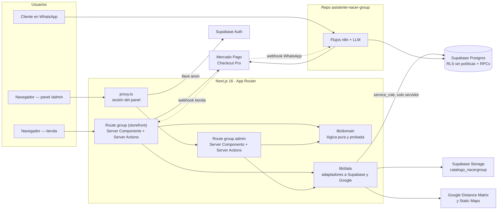
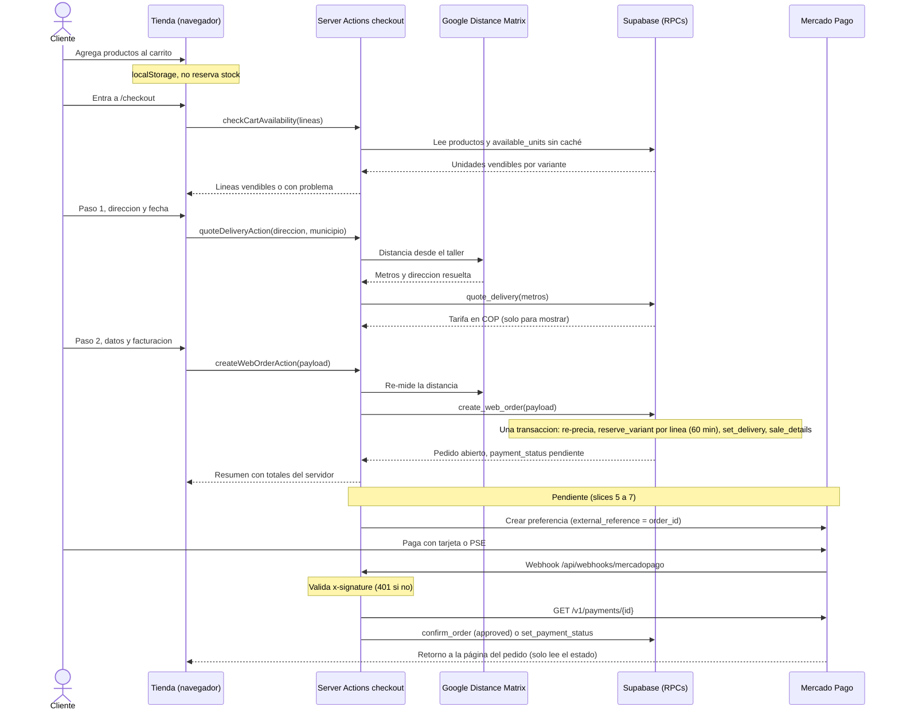

# Nacer Group — Tienda Crisálidas y Mariposas + Panel de administración

> Tienda en línea de Crisálidas y Mariposas y panel operativo interno de Nacer Group, sobre la misma base de datos que usa el asistente de ventas de WhatsApp.


---

## 1. Project Overview

Nacer Group vende hoy principalmente por WhatsApp, con un asistente de IA (n8n + LLM) que consulta el catálogo, reserva stock y cobra con Mercado Pago. Este repositorio agrega los otros dos frentes sobre la **misma base de Supabase**:

- **Tienda (`/`)**: catálogo de Crisálidas y Mariposas y su línea Complementos, carrito y checkout web.
- **Panel (`/admin`)**: reemplaza el Excel operativo — pedidos, despachos, producción, perdidos, productos e insumos, estadísticas y configuración del negocio.

Las dos apps comparten una sola fuente de verdad con el agente de WhatsApp: un pedido creado en la web, en el panel o en el chat se ve y se opera igual.

El contexto de negocio (marcas, catálogo, pendientes del cliente, bloqueantes, diseño del agente) vive en [`docs/contexto-negocio.md`](docs/contexto-negocio.md). Las reglas que no se negocian están en [`CLAUDE.md`](CLAUDE.md).

---

## 2. Architecture Overview

### Diagram



Puntos clave del diagrama:

- El navegador nunca habla con Supabase. Toda lectura y escritura pasa por Server Components o Server Actions.
- El esquema y las RPCs pertenecen al repo del asistente; esta app es un cliente más de la base.
- Cada canal recibe su propio webhook de Mercado Pago (la tienda en Next.js, WhatsApp en n8n), pero el único que deja un pedido pagado es `confirm_order` en la base (ADR-0010).

### Architecture Decisions

Las decisiones 0001–0006 tienen su documento completo en [`docs/adr/`](docs/adr/README.md):

| # | Decisión | Resumen |
|---|---|---|
| [0001](docs/adr/0001-proxy-ts-no-middleware-ts.md) | `proxy.ts` en vez de `middleware.ts` | Next.js 16 deprecó `middleware.ts`; mismo comportamiento con otro nombre. |
| [0002](docs/adr/0002-dos-clientes-supabase-panel.md) | Dos clientes de Supabase | `auth-server.ts` (anon, solo sesión) y `admin-client.ts` (`service_role`, `server-only`). |
| [0003](docs/adr/0003-fulfillment-status-columna-no-tabla.md) | `fulfillment_status` como columna | El cumplimiento es una dimensión aparte del pago; sin historial por ahora. |
| [0004](docs/adr/0004-correlativo-humano-configurable.md) | Correlativo de pedido en tabla | El prefijo (`TEST`, `C`, `D`…) se cambia con un `UPDATE`, sin migración. |
| [0005](docs/adr/0005-asesor-proveedor-texto-libre.md) | Asesor, proveedor y artesana como texto libre | Sin tablas catálogo hasta que haya volumen; asesor por defecto "Agente virtual". |
| [0006](docs/adr/0006-paleta-panel-separada-de-tienda.md) | Paleta del panel separada de la tienda | Tokens propios del panel, un solo acento de marca, colores de datos validados. |

Las siguientes decisiones se toman en el código y en `docs/plans/`, pero todavía no tienen archivo propio en `docs/adr/`:

#### ADR-0007: Base de datos compartida; el esquema vive en el repo del asistente

- **Decisión:** las migraciones (`db/migrations/NNN_*.sql`) y pruebas de esquema viven en `asistente-nacer-group`. Este repo solo guarda SQL de referencia en `docs/plans/*.sql` y consume tablas y RPCs.
- **Contexto:** el agente de WhatsApp ya creaba pedidos y reservas sobre Supabase antes de que existieran la tienda y el panel. Dos dueños del esquema significaban dos historias de migraciones divergentes.
- **Consecuencias:** un cambio de esquema para la web o el panel se aplica en el otro repo. `asistente-nacer-group/` está en `.gitignore`: es una copia local de consulta, no un submódulo.

#### ADR-0008: RLS habilitado sin políticas; todo acceso a datos en servidor

- **Decisión:** las tablas tienen RLS activo sin políticas, así que la llave anon no lee nada. La tienda y el panel leen con `service_role` desde el servidor y seleccionan columnas explícitas (nunca `select("*")`).
- **Contexto:** el catálogo tiene costos y unidades exactas que no deben llegar al navegador, y los pedidos contienen datos personales (Ley 1581).
- **Consecuencias:** el cliente recibe objetos `Producto` ya mapeados, sin `stock_qty` ni costos. La protección depende de que `admin-client.ts` nunca se importe desde un componente cliente; `server-only` hace fallar el build si pasa.

#### ADR-0009: Dominio puro en `lib/domain`, adaptadores en `lib/data`

- **Decisión:** reglas de negocio (vendibilidad, carrito, estados, calendario de entrega, SKUs, sesiones) como funciones puras con dependencias inyectadas (reloj, `DistanceProvider`). Probadas con `node --test` y el soporte nativo de TypeScript de Node, sin framework de pruebas.
- **Contexto:** lo que cuesta dinero si falla (totales, stock, transiciones) no debe depender de la UI ni de la red para probarse.
- **Consecuencias:** 878 pruebas corren en unos 2 segundos. Las importaciones dentro de `lib/domain` usan extensión `.ts` para que Node las resuelva. Los adaptadores (`lib/data/*`, `google-distance-provider.ts`) no tienen pruebas unitarias.

#### ADR-0010: La tienda confirma sus pagos con su propio webhook; `confirm_order` es la única escritura del pago

*Revisada el 2026-11-17. Reemplaza la versión anterior ("El pago web reutiliza el webhook de n8n").*

- **Decisión:**
  - Next.js crea el pedido y la preferencia de Checkout Pro con `external_reference = order.id`, `metadata.source = 'web'` y `notification_url` apuntando a su propio route handler (`/api/webhooks/mercadopago`). Solo tarjeta y PSE.
  - El handler valida `x-signature`: HMAC-SHA256 del manifiesto `id:<data.id en minúsculas>;request-id:<x-request-id>;ts:<ts>;`, comparado en tiempo constante.
  - Después consulta `GET /v1/payments/{id}` y decide **solo** con esa respuesta:
    - `approved` → `confirm_order`
    - `rejected` / `cancelled` → `set_payment_status('rechazado')`
    - `pending` / `in_process` → `set_payment_status('en_proceso')`
  - **`confirm_order` es la única función que deja un pedido pagado**, para los dos canales: descuenta stock, valida el monto y es idempotente por `payment_ref`. `set_payment_status` solo registra estados intermedios y nunca aprueba.
- **Contexto:**
  - La tienda no puede depender de que el asistente de WhatsApp esté arriba para confirmar ventas: el 2026-11-17 n8n estaba apagado.
  - La firma y la idempotencia, el área de riesgo crítico, vivían en un flujo de n8n sin versionar ni probar.
  - La regla de negocio ya vive en la base (`confirm_order`), así que mover el punto de entrada no la duplica.
  - El pago en efectivo tarda días y es incompatible con una reserva de 60 minutos; por eso sigue excluido.
- **Consecuencias:**
  - **Dos entradas, una conciliación.** n8n sigue atendiendo WhatsApp y su preferencia ya fija su propia `notification_url`. Lo duplicado es la verificación (firma y consulta), no la conciliación. Las dos entradas comparten el secreto de la aplicación de Mercado Pago.
  - **Firma inválida → 401.** Mercado Pago solo reintenta los avisos que él mismo envió, así que un aviso falsificado no se reintenta. En cambio, un aviso real rechazado por un secreto mal configurado sí se reintenta y se recupera al corregirlo. n8n responde 200 en ese caso; la tienda no copia ese comportamiento.
  - **Sin cola por ahora.** Se procesa en línea: la consulta y la RPC tardan muy por debajo de los 22 s que espera Mercado Pago. Si falla la consulta, se responde 500 para que Mercado Pago reenvíe el aviso. Los reintentos los absorbe `confirm_order`. Cuando Redis esté conectado se puede encolar sin cambiar el contrato.
  - **La página de retorno (`back_urls`) solo lee el estado.** Nunca confirma un pago.
  - **n8n debe ignorar los pedidos `web:`** por si el webhook configurado en el panel de Mercado Pago también le avisa de pagos web. Si alguno se cuela, el resultado sigue siendo correcto porque `confirm_order` es idempotente; solo sobran los efectos secundarios, como intentar escribirle por WhatsApp a un `chat_id` web.
  - **`TODO(decisión)`: avisos al operador** de venta web confirmada y de dinero cobrado sin pedido confirmado (doble cobro, reserva vencida, monto que no cuadra, PSE aprobado tras vencer la reserva). En WhatsApp los envía n8n por Gmail; para la tienda aún no hay canal definido.
  - **Nuevas variables:** `MP_ACCESS_TOKEN` y `MP_WEBHOOK_SECRET`. El servicio de Next.js en Railway no puede dormir.
  - Diseño del checkout en [`docs/plans/2026-10-21-cart-and-web-checkout-design.md`](docs/plans/2026-10-21-cart-and-web-checkout-design.md).

#### ADR-0011: El stock se retiene al crear el pedido, no al agregar al carrito

- **Decisión:** el carrito vive en `localStorage` y no reserva nada. Al entrar a `/checkout` se re-chequea disponibilidad sin reservar. Al enviar "Tus datos", la RPC atómica `create_web_order` reserva 60 minutos, fija la entrega y guarda los datos del comprador.
- **Contexto:** reservar por carrito dejaría que carritos abandonados bloquearan piezas únicas.
- **Consecuencias:** el cliente puede perder un producto entre el carrito y el checkout; se le avisa por línea antes de pedir datos. `create_web_order` es idempotente por `attempt_id` y puede reemplazar el intento anterior si el cliente vuelve atrás.

#### ADR-0012: Stock base por variante, sin recetas (migración 052)

- **Decisión:** cada variante comercial tiene un `stock_qty` base y `available_units` (columna calculada) descuenta las reservas activas no vencidas. Los insumos quedan como inventario independiente, sin vínculo a productos.
- **Contexto:** el modelo de recetas (BOM) por variante complicaba la carga y la operación sin que el negocio lo usara para costear.
- **Consecuencias:** se pierde el descuento automático de insumos al vender. Si se necesita costeo por pieza (fase 4 del contexto de negocio), habrá que reintroducir una relación producto–insumo.

#### ADR-0013: Sesión propia del panel encima de Supabase Auth

- **Decisión:** una cookie `httpOnly` firmada con HMAC-SHA256 (`ADMIN_SESSION_SECRET`) aplica 30 minutos de inactividad y 12 horas de vida absoluta. `proxy.ts` la evalúa y `requireAdminSession` la vuelve a verificar en el layout protegido y en cada Server Action.
- **Contexto:** las Server Actions corren con `service_role`, así que la sesión es la única barrera. Los tiempos de sesión configurables de Supabase dependen del plan.
- **Consecuencias:** la política no depende del plan de Supabase y se prueba como función pura. Hay una ruta `keepalive` y un guard de inactividad en el cliente para formularios largos.

#### ADR-0014: Rate limiting en memoria detrás de una interfaz

- **Decisión:** ventana deslizante en memoria (`lib/rateLimit.ts`) para login (por IP y por correo), mutaciones del panel y acciones públicas del checkout.
- **Contexto:** Redis está en el stack pero aún no conectado a esta app.
- **Consecuencias:** con más de una réplica, cada instancia cuenta por separado. Reemplazarlo por Redis no toca a quienes lo llaman (`TODO(redis)`).

#### ADR-0015: Catálogo cacheado 5 minutos con invalidación por tag

- **Decisión:** `unstable_cache` con `revalidate: 300` y tag `storefront-products`. El panel invalida el tag al publicar o despublicar. El checkout lee siempre fresco.
- **Contexto:** supabase-js no pasa por `fetch`, así que no se beneficia del caché de `fetch`. El catálogo es pequeño (unas 43 referencias).
- **Consecuencias:** la vitrina puede mostrar disponibilidad con hasta 5 minutos de desfase. Es aceptable porque el checkout y `create_web_order` vuelven a validar.

---

## 3. Scope & Boundaries

### En scope (implementado)

**Tienda**
- Home con hero animado por scroll (frames en `public/frames/`), sección de marcas, ocasiones, carrusel de destacados y principios de confianza.
- Catálogo de `crisalidas` y `complementos` publicados, con filtro por colección y rango de precio, y ficha de producto con galería, variantes y adicionales.
- Regla de vendibilidad: `Bajo pedido` se vende con stock 0; solo `Agotado` bloquea (`lib/domain/esVendible.ts`).
- Carrito persistido en el navegador, con drawer y píldora flotante.
- Checkout paso 1, Entrega: recogida en tienda o domicilio en el área metropolitana, distancia por Google Distance Matrix, tarifa por `quote_delivery` en la base, confirmación en mapa estático y calendario sin domingos ni festivos.
- Checkout paso 2, Tus datos: comprador, quien recibe, tarjeta y facturación, con creación del pedido pendiente vía `create_web_order`.
- Florea como sección informativa con enlace a su sitio externo. Jagua como presentación institucional.
- Páginas legales (términos, política de datos) y `about-us`.

**Panel**
- Login con Supabase Auth, expiración de sesión y límite de intentos.
- Pedidos: KPIs, gráficas, búsqueda, filtros por estado y periodo, detalle y alta manual de venta (incluye efectivo como fuente de pago solo del panel).
- Despachos con filtro de atrasados, Producción por día, Perdidos con seguimiento.
- Productos e insumos: ficha, precios, variantes, stock base, fotos versionadas en Storage y SKUs generados por marca y línea.
- Configuración: datos del negocio, horario y festivos.

### Fuera de scope

- No marca pedidos como pagados por su cuenta: su webhook verifica contra la API de Mercado Pago y delega en `confirm_order` (ADR-0010). Nunca desde el cuerpo del aviso ni desde la página de retorno.
- No procesa pagos en efectivo en la web.
- No define ni migra el esquema de la base (ver ADR-0007).
- No vende productos de Florea ni de Jagua como marca.
- No tiene cuentas de cliente, historial de compras ni cupones.
- No hace envíos nacionales: solo Medellín y área metropolitana, o recogida.
- No emite facturas electrónicas: solo captura los datos de facturación.
- No ejecuta ni modifica los flujos del agente de WhatsApp.

### Extensiones futuras

- **Checkout, slices 6 y 7:** página pública del pedido (`/pedido/[id]`) con comprobante en PDF, webhook propio de la tienda y que n8n ignore los pedidos `web:` (ADR-0010). El slice 5 (preferencia de Mercado Pago) ya está implementado.
- **Roles del panel:** hoy cualquier usuario autenticado puede todo (`TODO(roles)`). El modelo `admin` / `ventas` / `inventario` / `produccion` del contexto de negocio no está implementado.
- **Rate limiting en Redis** cuando haya más de una réplica.
- **Productos con agenda** (`requiere_agenda`, experiencias de liberación): ni el esquema ni `Producto` lo modelan todavía.
- **Retención de datos** de checkouts abandonados que vencen sin pagar.
- Página de marca (`/marca`), hoy un placeholder "próximamente".
- Venta de Florea en el sitio y facturación vía Aliaddo (fase 2 del contexto de negocio).

---

## 4. Tech Stack

| Tecnología | Versión | Rol | Por qué |
|---|---|---|---|
| Next.js (App Router) | 16.3.5 | Framework full-stack | Server Components y Server Actions permiten leer con `service_role` sin exponer una API pública propia. Tiene cambios que rompen convenciones previas: leer `node_modules/next/dist/docs/` antes de escribir código. |
| React | 19.2.8 | UI | Requerido por Next 16; Server Actions y transiciones nativas para formularios del panel y checkout. |
| TypeScript | 5.x | Lenguaje | Tipos del dominio (`lib/domain/types.ts`) compartidos entre tienda, panel y pruebas. |
| Supabase (`supabase-js`, `@supabase/ssr`) | 2.116 / 0.12 | Base de datos, Auth, Storage | Misma base que el agente de WhatsApp; RPCs atómicas en Postgres para reservas y pedidos. |
| Tailwind CSS | 4.x | Estilos | Utility-first con tokens en `app/globals.css` (tienda) y `app/admin/globals.css` (panel), separados a propósito (ADR 0006). |
| Framer Motion | 12.x | Animaciones de la tienda | Transiciones de checkout, carrito y secciones del home, siempre respetando `prefers-reduced-motion`. |
| Recharts | 3.x | Gráficas del panel | Gráficas declarativas en React para KPIs y estadísticas. |
| Zod | 4.x | Validación | Esquemas de entrada de Server Actions públicas (checkout) y formularios del panel. |
| `node:test` | Node ≥ 22.18 | Pruebas | Sin dependencias: Node ejecuta TypeScript directo. Suficiente para lógica pura. |
| Google Distance Matrix / Static Maps | — | Domicilio | Mismo cálculo de distancia que usa n8n, para que la tarifa web y la de WhatsApp coincidan. |
| Railway | — | Hosting | Donde ya corren n8n y Redis; Vercel está descartado explícitamente (ver `CLAUDE.md`). |

---

## 5. Project Structure

```
.
├── app/
│   ├── (storefront)/            # Tienda pública: root layout propio con fuentes y tokens de marca
│   │   ├── catalogo/            # Listado y ficha [slug]; lee el catálogo cacheado
│   │   ├── checkout/            # Flujo por pasos; actions.ts = endpoints públicos con rate limit
│   │   └── ...                  # about-us, marca, legales, not-found
│   ├── admin/                   # Panel: segundo root layout, tokens propios (globals.css)
│   │   ├── login/               # Única ruta de /admin sin sesión
│   │   ├── keepalive/           # Mantiene viva la sesión en formularios largos
│   │   └── (protected)/         # Todo lo que exige sesión; el layout vuelve a verificarla
│   │       ├── pedidos/ despachos/ produccion/ perdidos/
│   │       ├── productos/       # Productos comerciales + insumos/
│   │       ├── estadisticas/ configuracion/
│   │       └── ui/              # Componentes del panel (diálogos, combobox, inputs COP)
│   └── global-not-found.tsx     # 404 para URLs fuera de ambos layouts
├── components/                  # Componentes de la tienda, por zona (home, catalogo, cart, checkout…)
├── lib/
│   ├── domain/                  # Reglas de negocio puras + *.test.ts al lado. Sin red ni Next
│   │   └── checkout/            # Disponibilidad, calendario, tarifa, payload de create_web_order
│   ├── data/                    # Adaptadores: consultas Supabase, RPCs, Google. Todos server-only
│   ├── admin/                   # Sesión, guards y límites del panel
│   ├── supabase/                # Los dos clientes (ADR 0002) y el reintento por desfase de JWT
│   ├── content/                 # Textos de la tienda (marcas, home, legales) separados de la UI
│   └── motion/                  # Cálculos de animación probables sin DOM
├── hooks/                       # Hooks del hero (scrub de canvas, precarga de frames)
├── public/frames/               # Frames del hero generados con scripts/extract-frames.sh
├── scripts/                     # Herramientas puntuales: extracción de frames, carga inicial de insumos
├── specs/                       # Specs de producto numeradas (qué construir)
├── docs/
│   ├── adr/                     # Decisiones de arquitectura (cómo se construyó)
│   ├── plans/                   # Diseños por feature y SQL de referencia de RPCs
│   ├── contexto-negocio.md      # Documento maestro del negocio
│   └── reference/               # Material visual de referencia
├── .claude/                     # Agentes y skills del proyecto (nacer-dominio, nacer-pagos, nacer-motion)
├── proxy.ts                     # Puerta de /admin (antes middleware.ts, ADR 0001)
└── CLAUDE.md                    # Invariantes del negocio que ningún cambio puede violar
```

La regla de organización es de dependencias: `app/` y `components/` dependen de `lib/data` y `lib/domain`; `lib/data` depende de `lib/domain`; `lib/domain` no depende de nada del framework. Por eso todo `lib/domain` se prueba con `node --test` sin levantar Next ni Supabase.

---

## 6. Data Flow

Checkout web, del carrito al pedido pendiente. Lo que está debajo de la nota final es el diseño aprobado aún sin implementar.



---

## 7. Setup & Installation

### Requisitos previos

- Node.js ≥ 22.18 (las pruebas dependen de que Node ejecute TypeScript sin flags)
- npm ≥ 10
- Acceso al proyecto de Supabase `DB-nacer-group` para obtener las llaves
- Para el hero, solo si se regeneran frames: `ffmpeg`

### Instalación

```bash
git clone https://github.com/crisalidas-dev/ecommerce-crisalidas-y-mariposas.git
cd ecommerce-crisalidas-y-mariposas

npm install
cp .env.example .env.local   # completar con valores reales (ver sección 8)

npm run dev                  # tienda en http://localhost:3000, panel en /admin
```

El panel necesita un usuario creado en Supabase Auth. No hay registro desde la app.

### Scripts disponibles

| Comando | Descripción |
|---|---|
| `npm run dev` | Servidor de desarrollo |
| `npm run build` | Build de producción |
| `npm run start` | Sirve el build de producción |
| `npm run lint` | ESLint con la configuración de Next |
| `npm test` | Pruebas de `lib/` y de los view models del panel con `node --test` |
| `scripts/extract-frames.sh <video> <id>` | Genera los frames del hero en `public/frames/<id>/` |
| `python3 scripts/import-stock-items.py` | Carga inicial de insumos desde el Excel. Sin `--apply` es simulación. Solo para la primera carga |

---

## 8. Environment Variables

Todas son de servidor salvo la que lleva `NEXT_PUBLIC_`. Se definen en `.env.local` (cubierto por `.gitignore`).

| Variable | Requerida | Descripción | Ejemplo |
|---|---|---|---|
| `SUPABASE_URL` | Sí | URL del proyecto Supabase | `https://<ref>.supabase.co` |
| `SUPABASE_ANON_KEY` | Sí | Llave anon. Solo verifica sesión en `auth-server.ts` | `eyJ...` |
| `SUPABASE_SERVICE_ROLE_KEY` | Sí | **Secreta.** Salta RLS. Solo la usa `admin-client.ts` | `eyJ...` |
| `ADMIN_SESSION_SECRET` | Sí | Firma la cookie de sesión del panel (HMAC-SHA256) | cadena aleatoria de 32+ bytes |
| `GOOGLE_MAPS_SERVER_KEY` | No | Distance Matrix para el domicilio. Sin ella el checkout no cotiza, pero no se rompe | `AIza...` |
| `NEXT_PUBLIC_GOOGLE_MAPS_BROWSER_KEY` | No | Static Maps para confirmar la dirección. Pública: restringir por referrer | `AIza...` |
| `MP_ACCESS_TOKEN` | Para cobrar | **Secreta.** Access token de la aplicación de Mercado Pago (TEST en sandbox). Crea preferencias y consulta pagos | `APP_USR-...` / `TEST-...` |
| `MP_WEBHOOK_SECRET` | Para cobrar | **Secreta.** Clave de firma de Webhooks de la aplicación (la misma que usa n8n). Valida `x-signature` | 64 caracteres hex |
| `SITE_URL` | Para cobrar | URL pública de la tienda. Arma `back_urls` y `notification_url` de la preferencia | `https://tienda.nacergroup.co` |

El número de WhatsApp del header no es variable de entorno: es `WHATSAPP_NUMBER` en `lib/config.ts`, hoy con un placeholder (`TODO(cliente)`).

---

## 9. Contributing

### Flujo de trabajo

1. **Qué construir:** una spec en `specs/NNN_nombre/` (`spec.md`, `plan.md`, `tasks.md`) o un diseño en `docs/plans/AAAA-MM-DD-*.md`.
2. **Cómo se construyó:** si la decisión es costosa de deshacer, un ADR en `docs/adr/`.
3. **Código:** TDD en `lib/domain` (prueba que falla primero) y después la UI.
4. **Esquema:** la migración va en `asistente-nacer-group/db/migrations/`; aquí solo el SQL de referencia.

### Convenciones

- Vocabulario del negocio en español (`disponibilidad`, `precio_cop`), código e identificadores en inglés.
- Dinero en enteros COP, nunca `float`. Fechas en `America/Bogota`.
- Antes de tocar catálogo, pedidos o stock, cargar la skill `nacer-dominio`; antes de tocar pagos, `nacer-pagos`.

### Commits

[Conventional Commits](https://www.conventionalcommits.org/) con scope por zona:

```
feat(checkout): add delivery step with availability re-check and calendar
fix(admin): version stored image paths so replaced photos get a new URL
refactor(catalog): drop BOM recipes, sell commercial products from base stock
```
